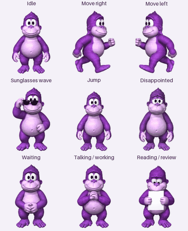

# Bonzi Buddy

A BonziBUDDY-inspired animated ChatGPT Pet. The artwork recreates the original
purple gorilla's appearance; it does not contain the original software, voice,
or animation frames.



## Files

- `assets/bonzi-buddy.png`: final transparent ChatGPT Pets v2 sprite sheet.
- `previews/`: animation overview, directional loop, MP4, contact sheet and stills.
- `pet.json`: format, provenance, checksum and validation summary.
- `validation/`: final structural, quality and direction reports.
- `scripts/verify.py`: checks the exact artifact and all required cells.
- `work/`: ignored generation sources, prompts, revisions and account-specific record.

The sheet is 1536 × 2288 pixels, with 192 × 208 cells in eight columns and eleven
rows. Its 73 frames cover nine animation states and sixteen clockwise look
directions. Unused cells remain transparent.

## Verify

Use Python 3 with Pillow installed:

```sh
python3 -m pip install -r requirements.txt
python3 scripts/verify.py
```

To regenerate motion previews, run `python3 scripts/preview.py`. With FFmpeg
installed, refresh the MP4 using:

```sh
ffmpeg -y -i previews/all-states.gif -movflags +faststart -pix_fmt yuv420p previews/all-states.mp4
```

Structural checks, the bundled pet quality gate and ChatGPT Pets preflight passed
on the final bytes. Independent reviewers confirmed the four cardinal looks.
The reports retain warnings for subtle intermediate directions and larger
changes where the two look strips meet. Toe and leg gaps are intentional.

## Creation and use

The canonical design and individual animation strips were generated with OpenAI
image generation, grounded in the same character reference. The ChatGPT Pet
creation tools extracted the poses, assembled the sheet, removed background
spill and rendered previews. Generation is not a deterministic rebuild.

Bonzi Buddy was created and verified in ChatGPT Pets on October 12, 2026.
Selection as the active pet is separate from creation. The account-specific pet
ID is kept in ignored `work/installed-pet.json`.

The repository sheet includes a later padding correction for four look-up poses.
The installed pet still uses the earlier sheet; this repository setup did not
replace its stored artwork.

For future changes, preserve the approved character proportions, regenerate only
the affected source strips, rerun the complete final validation, and show motion
previews before uploading. Do not rotate or warp a sprite to invent look poses.

## License and provenance

Project code and documentation use the [MIT license](LICENSE).
Character artwork is excluded; see [NOTICE](NOTICE) for its separate rights status.

Visual reference: [Bonzi Buddy image on PNGAAA](https://www.pngaaa.com/detail/2991702).
That page labels its reference image for non-commercial use. The downloaded
reference and rejected revisions are retained locally in ignored `work/`.
This is an unofficial fan recreation with no affiliation claim.
